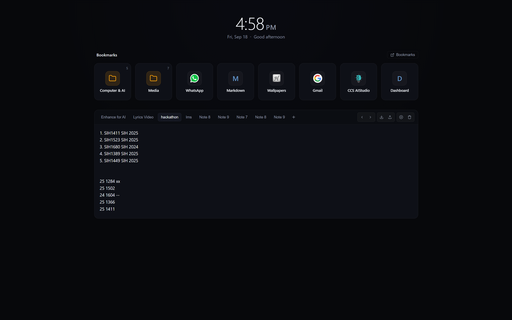

# Custom New Tab

A lightweight, fast, and modern dark-themed dashboard for your browser. This extension replaces the default new tab page with an elegant interface featuring an unobtrusive clock and date, browser bookmarks integration, and persistent multi-tab notes.

## Screenshots

## Features

- **Modern Minimalist Design**: Premium dark obsidian theme with crisp typography and subtle micro-interactions.
- **Clock & Date Widget**: Clean, tabular digital clock, formatted date, and contextual greeting with zero layout shift.
- **Bookmarks Integration**: Quick access to your browser bookmarks bar in a tactile grid with automatic favicon caching, folder navigation, and breadcrumbs.
- **Persistent Notes Workspace**: Built-in multi-tab notes system with inline tab renaming, drag-and-drop reordering, keyboard shortcuts, character/word counters, automatic saving, undo delete, and JSON export/import.
- **Lightweight & High Performance**: Zero heavy dependencies, zero build steps, vanilla ES modules, pure CSS animations, and minimal memory footprint (<50KB total).

## Installation

To install this extension in Chrome or any Chromium-based browser (Edge, Brave, Arc, etc.):

1. Download or clone this repository to your local machine.
2. Open your browser and navigate to `chrome://extensions/`.
3. Enable **Developer mode** by toggling the switch in the top right corner.
4. Click on **Load unpacked**.
5. Select the folder containing the extension files.

## Usage

- **Bookmarks**: Click any bookmark to open it in a new tab. Click on folders or breadcrumbs to navigate your bookmarks hierarchy. Use the **Bookmarks** shortcut button to open Chrome's bookmarks manager (`chrome://bookmarks`).
- **Notes**:
  - Click `+` to create a new note tab.
  - Click the active tab to rename it.
  - Drag and drop tabs or press `Alt + Left` / `Alt + Right` to reorder.
  - Use the toolbar icons to Undo deletion, Export/Import JSON backups, Clear note text, or Delete tabs.
  - Text saves automatically as you type.

## Permissions

This extension only requires local permissions:
- `bookmarks`: To read and display your browser bookmarks bar.
- `storage`: To save your notes and cache favicons locally.

